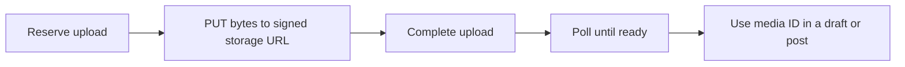

Use your installation's **API origin**, not the documentation or UI origin. The reference documents every registered HTTP operation, including publishing, media, account sessions, team administration, OAuth and health. Each sidebar entry opens one endpoint with its parameters, request body and responses. Download the [OpenAPI specification](/api-reference/openapi.json) to build a client.

## Authentication

| Client or operation                                         | Authentication                                                                                                            |
| ----------------------------------------------------------- | ------------------------------------------------------------------------------------------------------------------------- |
| Publishing and team REST operations                         | A personal or team [API key](/api-keys) in `Authorization: Bearer …`, bounded by its stored policy and current authority. |
| Browser account, passkey, invitation and API-key management | A signed-in human `posted_session` cookie. These operations explicitly reject API-key and MCP impersonation.              |
| MCP tool calls                                              | An OAuth bearer credential issued for the `/mcp` resource. Follow [MCP connections](/mcp-connections).                    |
| Client registration and token exchange                      | OAuth client rules and S256 PKCE, as described on their endpoint pages.                                                   |
| Setup, recovery, callbacks and health                       | No session where indicated; endpoint-specific setup secrets, state, recovery tokens or challenges still apply.            |

For browser changes carrying cookies, send the exact configured UI `Origin`. Any supplied Origin must match that UI origin. A server-side API client should send its bearer credential without browser cookies. Credentials and signed media URLs belong in private client storage.

## Request and response format

JSON endpoints use `Content-Type: application/json`. OAuth token and revocation requests use `application/x-www-form-urlencoded`. A DELETE draft request includes a JSON body with `version`; cancelling a published posting group does not delete it from the provider.

Examples use fictional UUIDs and sample content. The reference uses simple examples rather than sending requests to a live social account. Replace the example API server and IDs with your installation's values before using a private client.

## Versions and safe retries

Post creation and draft saving require a content-bound `idempotencyKey`. Keep the key and payload identical when retrying the same logical operation. Use a new key for a deliberate new operation; reusing a key for different content returns a conflict. Scheduled-post edits and draft saves use the current `version`. A stale version returns a conflict instead of overwriting another user's work.

When publishing a saved draft, include `draftSource: { id, version }` so conversion happens once. A successful create response acknowledges the stored posting request; it does not confirm external publication. Read the post's `deliveries` afterward.

## Threads and per-account content

The root text/media form post index 0. `additionalPosts` holds later posts in order. `textOverrides` and `mediaOverrides` are keyed by selected connection IDs. Each `mediaOverrides` value is an ordered list of media IDs. Omit the account key to inherit master attachments; use an empty list to intentionally select no media for that account. Resetting text and media inheritance removes both override keys. Responses resolve attachment IDs into media objects.

X, Threads and Bluesky form linked replies; LinkedIn publishes individual posts in order. A preceding failure or uncertain outcome prevents later posts on that account from being sent. See [Compose threads](/threads).

## Private media workflow



Use the upload reservation's exact headers and byte size. Video completion can return HTTP 202 while preparation runs; wait for ready before creating a post. Preview URLs are short-lived. See [media configuration](/configuration#private-media-storage) and the individual media endpoints.

## Pagination

Posts and drafts use numbered `page` / `pageSize` pagination, with a maximum page size of 100. Responses contain `items`, `total`, `page` and `pageSize`. Credentials and invitations use `limit` and `cursor`; members use an opaque cursor tied to the collection revision. Return `nextCursor` unchanged. Cursor responses contain `items`, `hasMore` and `nextCursor`.

## Errors and request IDs

```json
{
  "error": {
    "code": "CONFLICT",
    "message": "This item changed. Reload it before saving.",
    "requestId": "example-request-id"
  }
}
```

The API returns `X-Request-Id` and uses the same ID in the standard JSON error envelope. OAuth failures instead use OAuth `error` and `error_description` fields; the MCP transport can return JSON-RPC errors.

| Status | Meaning and next step                                                                    |
| ------ | ---------------------------------------------------------------------------------------- |
| 400    | Invalid input or state. Correct it before retrying.                                      |
| 401    | Missing, expired or revoked authentication. Sign in or authorize again.                  |
| 403    | The role, credential policy, recent authentication or Origin does not permit the action. |
| 404    | The target is unavailable to this team, or an optional feature is disabled.              |
| 409    | A version, collection revision or request key conflicts. Read the latest state.          |
| 413    | The request exceeds the endpoint's body limit.                                           |
| 422    | Media preparation failed. Upload a supported file.                                       |
| 429    | A rate limit was reached. Respect `Retry-After`.                                         |
| 503    | A required service, storage, SMTP or database is unavailable.                            |

General limits are 120 anonymous or 240 authenticated requests per minute, with stricter limits on individual authentication flows. Do not retry an uncertain external publication blindly. Read per-account delivery outcomes and inspect the provider first.
