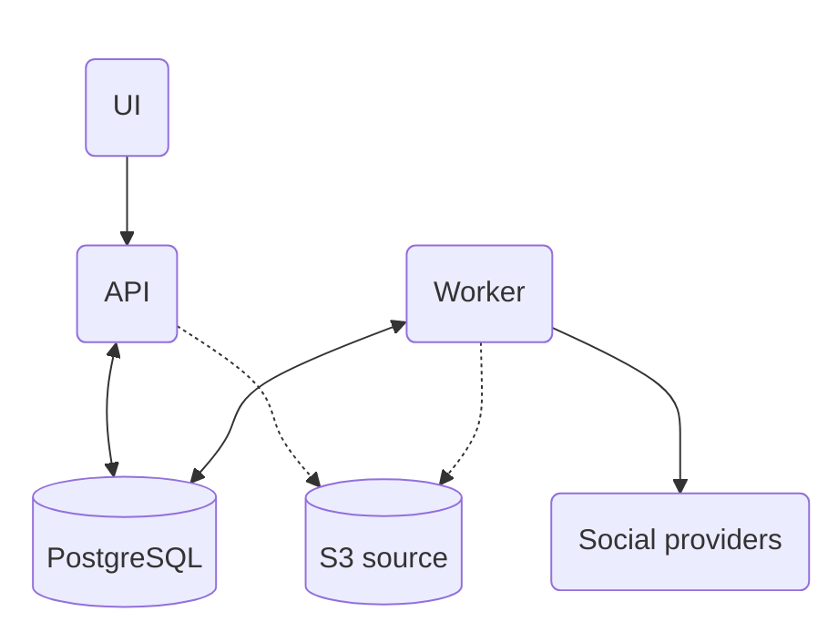

# Architecture overview

Posted runs three services: UI, API and Worker. PostgreSQL stores their shared data.

| Component  | What it does                                                                          |
| ---------- | ------------------------------------------------------------------------------------- |
| UI         | The web application for composing posts, managing accounts and reviewing results.     |
| API        | Handles sign-in, team permissions, drafts, publishing requests, REST and MCP clients. |
| Worker     | Picks up scheduled work, prepares media and publishes to connected accounts.          |
| PostgreSQL | Stores accounts, drafts, schedules and delivery results.                              |
| S3 source  | Keeps uploaded images and videos in an S3-compatible bucket when media is enabled.    |

Only the UI and API need public HTTPS routes. The worker and PostgreSQL stay private. Each release provides matching API, worker and UI images for Linux AMD64 and ARM64.

## How publishing works

1. You write a post in the UI or send it through the API or MCP. The API checks permissions and saves it in PostgreSQL.
2. A saved draft stays editable without entering the delivery queue. A publishing request creates scheduled work for each selected account.
3. The worker picks up due work, prepares any media and sends each post to its provider.
4. The UI reads the results from the API. Each account has its own delivery outcome, so you can see partial success or a result that needs review.

Schedules and delivery state live in PostgreSQL, so they survive service restarts. There is no separate message-queue service to install.

## Choose an installation method

<CardGroup cols={2}>
  <Card title="Docker Compose" icon="/assets/installation/docker-compose.png" href="/installation/docker-compose">Run Posted on your server with Docker. Includes a bundled PostgreSQL setup and an option to use your existing database.</Card>
  <Card title="Towbar" icon="/assets/installation/towbar.png" href="/installation/towbar">Manage Posted through a connected Git repository, deployment manifests and runtime settings in Towbar.</Card>
</CardGroup>

Building from source uses the [Docker Compose build option](/installation/docker-compose#build-from-source).

After installation, use [Configuration](/configuration) to enable providers and media, and set up [backups](/backup) before storing production data.
