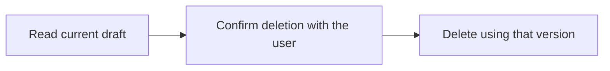

Delete a team draft using its current version. Ask the user before deleting their draft.

## Workflow



## Access and behavior

Write or Administrator OAuth consent and a member/administrator team role are required. Tools are listed and callable only when the current grant and role permit them.

Deletion removes the draft for the team. A stale version returns a conflict; read again before asking the user to confirm a new deletion.

<Warning>
  Confirm the exact target and consequence with the user before calling this
  tool.
</Warning>

## Arguments

| Argument  | Required | Type or meaning                                                                       |
| --------- | -------- | ------------------------------------------------------------------------------------- |
| `draftId` | Yes      | Draft UUID; choose a new UUID when creating, or read the saved draft before updating. |
| `version` | Yes      | Latest record version; use 0 only when creating a new draft.                          |

<Accordion title="Complete input schema">

```json
{
  "type": "object",
  "properties": {
    "draftId": {
      "type": "string",
      "format": "uuid",
      "pattern": "^([0-9a-fA-F]{8}-[0-9a-fA-F]{4}-[1-8][0-9a-fA-F]{3}-[89abAB][0-9a-fA-F]{3}-[0-9a-fA-F]{12}|00000000-0000-0000-0000-000000000000|ffffffff-ffff-ffff-ffff-ffffffffffff)$"
    },
    "version": {
      "type": "integer",
      "exclusiveMinimum": 0,
      "maximum": 9007199254740991
    }
  },
  "required": ["draftId", "version"],
  "additionalProperties": false
}
```

</Accordion>

## Example call

The client initializes the MCP connection before sending this JSON-RPC call. Example records are fictional.

```json
{
  "jsonrpc": "2.0",
  "id": 1,
  "method": "tools/call",
  "params": {
    "name": "delete_draft",
    "arguments": {
      "draftId": "33333333-3333-4333-8333-333333333333",
      "version": 1
    }
  }
}
```

## Example result

Posted returns this object in `structuredContent` and a JSON text content block. A tool failure sets `isError`; never treat an error as a completed mutation.

```json
{
  "completed": true
}
```

## Related reference

[HTTP operation](/api-reference/delete_api_drafts_by_draftId) · [Connect an MCP client](/mcp-connections) · [Request conventions](/api-reference/overview)
