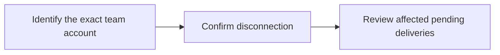

Disconnect a team social account. Pending deliveries will fail. Ask the user before disconnecting.

## Workflow



## Access and behavior

Administrator consent and a current administrator team role are required. Tools are listed and callable only when the current grant and role permit them.

Requires Administrator access. Scheduled deliveries for this account fail after disconnection. Previously published provider posts remain in place.

<Warning>
  Confirm the exact target and consequence with the user before calling this
  tool.
</Warning>

## Arguments

| Argument       | Required | Type or meaning                                        |
| -------------- | -------- | ------------------------------------------------------ |
| `connectionId` | Yes      | Team social-account UUID returned by list_connections. |

<Accordion title="Complete input schema">

```json
{
  "type": "object",
  "properties": {
    "connectionId": {
      "type": "string",
      "format": "uuid",
      "pattern": "^([0-9a-fA-F]{8}-[0-9a-fA-F]{4}-[1-8][0-9a-fA-F]{3}-[89abAB][0-9a-fA-F]{3}-[0-9a-fA-F]{12}|00000000-0000-0000-0000-000000000000|ffffffff-ffff-ffff-ffff-ffffffffffff)$"
    }
  },
  "required": ["connectionId"],
  "additionalProperties": false
}
```

</Accordion>

## Example call

The client initializes the MCP connection before sending this JSON-RPC call. Example records are fictional.

```json
{
  "jsonrpc": "2.0",
  "id": 1,
  "method": "tools/call",
  "params": {
    "name": "disconnect_account",
    "arguments": {
      "connectionId": "11111111-1111-4111-8111-111111111111"
    }
  }
}
```

## Example result

Posted returns this object in `structuredContent` and a JSON text content block. A tool failure sets `isError`; never treat an error as a completed mutation.

```json
{
  "completed": true
}
```

## Related reference

[HTTP operation](/api-reference/delete_api_connections_by_connectionId) · [Connect an MCP client](/mcp-connections) · [Request conventions](/api-reference/overview)
