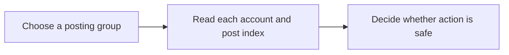

Read a posting group, its media and individual account outcomes.

## Workflow



## Access and behavior

A Read-only, Write or Administrator OAuth grant can call this tool within the user’s current team role. Tools are listed and callable only when the current grant and role permit them.

The root and additionalPosts represent the ordered sequence. deliveries contains a separate state for every account and postIndex. A group can be partial even if some posts were published.

## Arguments

| Argument | Required | Type or meaning                                           |
| -------- | -------- | --------------------------------------------------------- |
| `postId` | Yes      | Posting-group UUID returned by list_posts or create_post. |

<Accordion title="Complete input schema">

```json
{
  "type": "object",
  "properties": {
    "postId": {
      "type": "string",
      "format": "uuid",
      "pattern": "^([0-9a-fA-F]{8}-[0-9a-fA-F]{4}-[1-8][0-9a-fA-F]{3}-[89abAB][0-9a-fA-F]{3}-[0-9a-fA-F]{12}|00000000-0000-0000-0000-000000000000|ffffffff-ffff-ffff-ffff-ffffffffffff)$"
    }
  },
  "required": ["postId"],
  "additionalProperties": false
}
```

</Accordion>

## Example call

The client initializes the MCP connection before sending this JSON-RPC call. Example records are fictional.

```json
{
  "jsonrpc": "2.0",
  "id": 1,
  "method": "tools/call",
  "params": {
    "name": "get_post",
    "arguments": {
      "postId": "22222222-2222-4222-8222-222222222222"
    }
  }
}
```

## Example result

Posted returns this object in `structuredContent` and a JSON text content block. A tool failure sets `isError`; never treat an error as a completed mutation.

```json
{
  "post": {
    "resumableConnectionIds": [],
    "id": "22222222-2222-4222-8222-222222222222",
    "text": "A small update from the studio.",
    "additionalPosts": [],
    "mediaOverrides": {},
    "scheduledAt": "2027-01-18T09:30:00.000Z",
    "idempotencyKey": "studio-update-2027-01-18",
    "state": "scheduled",
    "version": 1,
    "createdAt": "2027-01-18T09:30:00.000Z",
    "media": [
      {
        "id": "44444444-4444-4444-8444-444444444444",
        "fileName": "studio.jpg",
        "contentType": "image/jpeg",
        "sizeBytes": 245760,
        "width": 1600,
        "height": 900,
        "alt": "A bright studio desk beside a window",
        "durationSeconds": null
      }
    ],
    "managedBy": {
      "id": "66666666-6666-4666-8666-666666666666",
      "name": "Alex Morgan",
      "avatarUrl": null
    },
    "deliveries": [
      {
        "id": "77777777-7777-4777-8777-777777777777",
        "postIndex": 0,
        "connectionId": "11111111-1111-4111-8111-111111111111",
        "provider": "bluesky",
        "accountName": "Alex Morgan",
        "accountHandle": "alex.example.test",
        "accountAvatarUrl": null,
        "textOverride": null,
        "state": "scheduled",
        "attempts": 0,
        "nextAttemptAt": null,
        "providerPostId": null,
        "publishedUrl": null,
        "error": null,
        "publishedAt": null
      }
    ]
  }
}
```

## Related reference

[HTTP operation](/api-reference/get_api_posts_by_postId) · [Connect an MCP client](/mcp-connections) · [Request conventions](/api-reference/overview)
