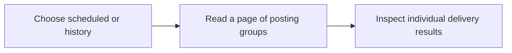

List scheduled posts or post history with per-account delivery states.

## Workflow



## Access and behavior

A Read-only, Write or Administrator OAuth grant can call this tool within the user’s current team role. Tools are listed and callable only when the current grant and role permit them.

Scheduled includes groups with a scheduled, preparing or publishing delivery. History includes the remaining groups, including failed, uncertain and cancelled outcomes. It is not a list of confirmed publications alone.

## Arguments

| Argument   | Required | Type or meaning                                                           |
| ---------- | -------- | ------------------------------------------------------------------------- |
| `view`     | No       | scheduled for pending work, history for groups without active deliveries. |
| `page`     | No       | One-based page number.                                                    |
| `pageSize` | No       | Records per numbered page, at most 100.                                   |

<Accordion title="Complete input schema">

```json
{
  "type": "object",
  "properties": {
    "view": {
      "type": "string",
      "enum": ["scheduled", "history"]
    },
    "page": {
      "type": "integer",
      "minimum": 1,
      "maximum": 9007199254740991
    },
    "pageSize": {
      "type": "integer",
      "minimum": 1,
      "maximum": 100
    }
  },
  "additionalProperties": false
}
```

</Accordion>

## Example call

The client initializes the MCP connection before sending this JSON-RPC call. Example records are fictional.

```json
{
  "jsonrpc": "2.0",
  "id": 1,
  "method": "tools/call",
  "params": {
    "name": "list_posts",
    "arguments": {
      "view": "scheduled",
      "page": 1,
      "pageSize": 20
    }
  }
}
```

## Example result

Posted returns this object in `structuredContent` and a JSON text content block. A tool failure sets `isError`; never treat an error as a completed mutation.

```json
{
  "items": [
    {
      "id": "22222222-2222-4222-8222-222222222222",
      "text": "A small update from the studio.",
      "additionalPosts": [],
      "mediaOverrides": {},
      "scheduledAt": "2027-01-18T09:30:00.000Z",
      "idempotencyKey": "studio-update-2027-01-18",
      "state": "scheduled",
      "version": 1,
      "createdAt": "2027-01-18T09:30:00.000Z",
      "media": [
        {
          "id": "44444444-4444-4444-8444-444444444444",
          "fileName": "studio.jpg",
          "contentType": "image/jpeg",
          "sizeBytes": 245760,
          "width": 1600,
          "height": 900,
          "alt": "A bright studio desk beside a window",
          "durationSeconds": null
        }
      ],
      "managedBy": {
        "id": "66666666-6666-4666-8666-666666666666",
        "name": "Alex Morgan",
        "avatarUrl": null
      },
      "deliveries": [
        {
          "id": "77777777-7777-4777-8777-777777777777",
          "postIndex": 0,
          "connectionId": "11111111-1111-4111-8111-111111111111",
          "provider": "bluesky",
          "accountName": "Alex Morgan",
          "textOverride": null,
          "state": "scheduled",
          "providerPostId": null,
          "publishedUrl": null,
          "error": null,
          "publishedAt": null
        }
      ]
    }
  ],
  "total": 1,
  "page": 1,
  "pageSize": 20
}
```

## Related reference

[HTTP operation](/api-reference/get_api_posts) · [Connect an MCP client](/mcp-connections) · [Request conventions](/api-reference/overview)
