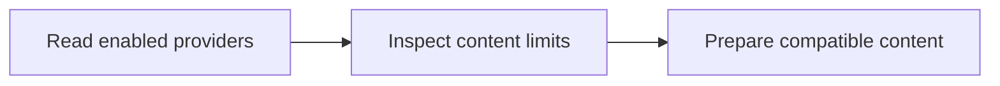

Read enabled providers and their content limits.

## Workflow



## Access and behavior

A Read-only, Write or Administrator OAuth grant can call this tool within the user’s current team role. Tools are listed and callable only when the current grant and role permit them.

Only fully configured providers appear. This returns Posted's enforced capabilities, not an assurance that a provider application has production approval.

## Arguments

| Argument | Required | Type or meaning       |
| -------- | -------- | --------------------- |
| None     | No       | Pass an empty object. |

<Accordion title="Complete input schema">

```json
{
  "type": "object",
  "properties": {},
  "additionalProperties": false
}
```

</Accordion>

## Example call

The client initializes the MCP connection before sending this JSON-RPC call. Example records are fictional.

```json
{
  "jsonrpc": "2.0",
  "id": 1,
  "method": "tools/call",
  "params": {
    "name": "list_providers",
    "arguments": {}
  }
}
```

## Example result

Posted returns this object in `structuredContent` and a JSON text content block. A tool failure sets `isError`; never treat an error as a completed mutation.

```json
{
  "providers": [
    {
      "id": "bluesky",
      "name": "Bluesky",
      "maxCharacters": 300,
      "maxImages": 4,
      "maxVideos": 1,
      "maxVideoDurationSeconds": 180,
      "maxImageBytes": 2000000,
      "maxImageDimension": 4000
    }
  ]
}
```

## Related reference

[HTTP operation](/api-reference/get_api_providers) · [Connect an MCP client](/mcp-connections) · [Request conventions](/api-reference/overview)
