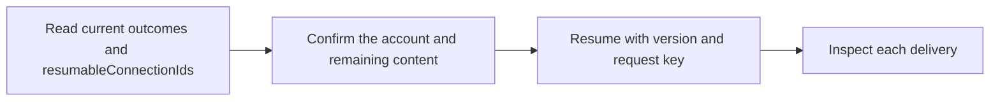

Resume an interrupted account's unpublished posts using its current version. Confirm the account and remaining content with the user. Published posts are preserved; uncertain results cannot be resumed. Reuse the same idempotencyKey for retries.

## Workflow



## Access and behavior

Write or Administrator OAuth consent and a member/administrator team role are required. Tools are listed and callable only when the current grant and role permit them.

Resume one connected account's failed remainder without creating a new posting group. Confirmed posts, their IDs and original request key are preserved. Active, cancelled or uncertain sequences cannot be resumed. Reuse the same resume key and payload after a lost response. A new failure requires a new key and the latest group version.

## Arguments

| Argument         | Required | Type or meaning                                                                |
| ---------------- | -------- | ------------------------------------------------------------------------------ |
| `connectionId`   | Yes      | Team social-account UUID returned by list_connections.                         |
| `version`        | Yes      | Latest record version; use 0 only when creating a new draft.                   |
| `idempotencyKey` | Yes      | One content-bound request key; reuse with the identical payload when retrying. |
| `postId`         | Yes      | Posting-group UUID returned by list_posts or create_post.                      |

<Accordion title="Complete input schema">

```json
{
  "type": "object",
  "properties": {
    "connectionId": {
      "type": "string",
      "format": "uuid",
      "pattern": "^([0-9a-fA-F]{8}-[0-9a-fA-F]{4}-[1-8][0-9a-fA-F]{3}-[89abAB][0-9a-fA-F]{3}-[0-9a-fA-F]{12}|00000000-0000-0000-0000-000000000000|ffffffff-ffff-ffff-ffff-ffffffffffff)$"
    },
    "version": {
      "type": "integer",
      "exclusiveMinimum": 0,
      "maximum": 9007199254740991
    },
    "idempotencyKey": {
      "type": "string",
      "pattern": "^[A-Za-z0-9._:-]{8,128}$"
    },
    "postId": {
      "type": "string",
      "format": "uuid",
      "pattern": "^([0-9a-fA-F]{8}-[0-9a-fA-F]{4}-[1-8][0-9a-fA-F]{3}-[89abAB][0-9a-fA-F]{3}-[0-9a-fA-F]{12}|00000000-0000-0000-0000-000000000000|ffffffff-ffff-ffff-ffff-ffffffffffff)$"
    }
  },
  "required": ["connectionId", "version", "idempotencyKey", "postId"],
  "additionalProperties": false
}
```

</Accordion>

## Example call

The client initializes the MCP connection before sending this JSON-RPC call. Example records are fictional.

```json
{
  "jsonrpc": "2.0",
  "id": 1,
  "method": "tools/call",
  "params": {
    "name": "resume_post",
    "arguments": {
      "postId": "22222222-2222-4222-8222-222222222222",
      "connectionId": "11111111-1111-4111-8111-111111111111",
      "version": 1,
      "idempotencyKey": "studio-resume-2027-01-18"
    }
  }
}
```

## Example result

Posted returns this object in `structuredContent` and a JSON text content block. A tool failure sets `isError`; never treat an error as a completed mutation.

```json
{
  "post": {
    "resumableConnectionIds": [],
    "id": "22222222-2222-4222-8222-222222222222",
    "text": "A small update from the studio.",
    "additionalPosts": [],
    "mediaOverrides": {},
    "scheduledAt": "2027-01-18T09:30:00.000Z",
    "idempotencyKey": "studio-update-2027-01-18",
    "state": "scheduled",
    "version": 2,
    "createdAt": "2027-01-18T09:30:00.000Z",
    "media": [
      {
        "id": "44444444-4444-4444-8444-444444444444",
        "fileName": "studio.jpg",
        "contentType": "image/jpeg",
        "sizeBytes": 245760,
        "width": 1600,
        "height": 900,
        "alt": "A bright studio desk beside a window",
        "durationSeconds": null
      }
    ],
    "managedBy": {
      "id": "66666666-6666-4666-8666-666666666666",
      "name": "Alex Morgan",
      "avatarUrl": null
    },
    "deliveries": [
      {
        "id": "77777777-7777-4777-8777-777777777777",
        "postIndex": 0,
        "connectionId": "11111111-1111-4111-8111-111111111111",
        "provider": "bluesky",
        "accountName": "Alex Morgan",
        "accountHandle": "alex.example.test",
        "accountAvatarUrl": null,
        "textOverride": null,
        "state": "scheduled",
        "attempts": 0,
        "nextAttemptAt": null,
        "providerPostId": null,
        "publishedUrl": null,
        "error": null,
        "publishedAt": null
      }
    ]
  }
}
```

## Related reference

[HTTP operation](/api-reference/post_api_posts_by_postId_resume) · [Connect an MCP client](/mcp-connections) · [Request conventions](/api-reference/overview)
