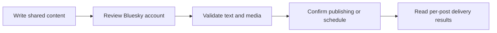

Connect a Bluesky account through official AT Protocol OAuth. Posted uses PKCE, DPoP and private-key client authentication rather than asking for an account password or app password.

## Connect an account

<Steps>
  <Step title="Configure the provider">
    Add the required environment variables below to your Posted installation.
  </Step>
  <Step title="Authorize the account">
    A team administrator opens **Connections → Add connection**, chooses
    **Bluesky**, and completes the provider’s sign-in and consent flow.
  </Step>
  <Step title="Choose it in the composer">
    After returning to Posted, confirm that the account is Connected. Select it
    through **Choose Accounts**, review its preview and customize its text or
    media if needed.
  </Step>
</Steps>

Accounts belong to the team. Connecting the same provider account again refreshes the existing connection. Members can compose for connected accounts; only administrators can add or disconnect them.

## Required environment variables

Add these values to both the API and worker services, then restart them to apply the configuration.

```dotenv title="Environment variables"
POSTED_BLUESKY_CLIENT_ID={{POSTED_API_URL}}/social/bluesky/client-metadata.json
POSTED_BLUESKY_PRIVATE_KEY_JWK=YOUR_PRIVATE_JWK_JSON
```

## Application configuration

Posted serves your OAuth client metadata at:

```text title="Client metadata URL"
{{POSTED_API_URL}}/social/bluesky/client-metadata.json
```

The metadata includes this callback URL:

```text title="Callback URL"
{{POSTED_API_URL}}/api/social/callback/bluesky
```

Public signing keys are served at:

```text title="Public signing keys URL"
{{POSTED_API_URL}}/social/bluesky/jwks.json
```

The metadata and public keys must be publicly reachable over HTTPS. The private signing key stays on your server.

Use an EC P-256 signing key. See [Generate a Bluesky signing key](/providers#generate-a-bluesky-signing-key) for the command.

Posted requests `atproto`, `transition:generic`.

Follow the provider's [official authorization documentation](https://atproto.com/specs/oauth) to register your application and complete any approval steps.

## Limits enforced by Posted

| Content        | Posted behavior                    |
| -------------- | ---------------------------------- |
| Text           | 300 grapheme clusters per post     |
| Attachments    | Up to 4 images **or** one video    |
| Video duration | 3–180 seconds                      |
| Sequence       | Linked replies after the root post |

These are Posted’s current delivery limits. Use [list_providers](/mcp-reference/list_providers) or the provider API endpoint to inspect the running installation’s capabilities. Uploaded originals are prepared for the provider at delivery time; provider account permissions and quotas still apply.

## Posts, media and threads

Enter your Bluesky handle when beginning the connection, for example name.bsky.social. The provider flow discovers the account’s server. In a thread, each reply retains the first publication as its root and the preceding publication as its parent.

Each post has independent text and attachment order. Account-specific edits affect only that account and post. **Reset to master** restores text and media inheritance after confirmation. Image or video publishing requires [S3 source](/configuration#s3-source).



Read [Compose a post](/composer) for single posts and [Compose threads](/threads) for insertion, ordering, reply links and failure handling.

## Reconnect and troubleshoot

If the account needs reauthentication, an administrator repeats the official authorization flow. If Bluesky is missing from Add connection, ask the operator to check the complete provider configuration and deploy the saved runtime values. A callback mismatch must be corrected in the provider application using the API origin, not the UI or documentation domain.

Inspect [Publish history](/deliveries) for each account's result. A confirmed provider publication stays published if another account fails. An **Uncertain** result needs provider-side inspection before another posting request. Disconnecting prevents later use of the account and does not remove existing provider posts.
