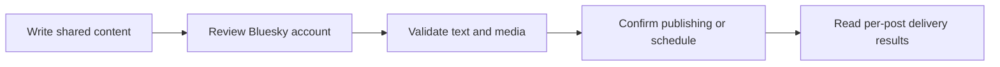

Connect a Bluesky account through official AT Protocol OAuth. Posted uses PKCE, DPoP and private-key client authentication rather than asking for an account password or app password.

## Connect an account

<Steps>
  <Step title="Configure the provider">
    The installation operator supplies `POSTED_BLUESKY_CLIENT_ID` and
    `POSTED_BLUESKY_PRIVATE_KEY_JWK` to both API and worker. The OAuth client ID
    is the public client-metadata URL served by this API. Generate a private EC
    P-256 JWK and keep the same signing key on both API and worker. The private
    key stays on the server; only public keys are served.
  </Step>
  <Step title="Authorize the account">
    A team administrator opens **Connections → Add connection**, chooses
    **Bluesky**, and completes the provider’s sign-in and consent flow.
  </Step>
  <Step title="Choose it in the composer">
    After returning to Posted, confirm that the account is Connected. Select it
    through **Choose Accounts**, review its preview and customize its text or
    media if needed.
  </Step>
</Steps>

Accounts belong to the team. Connecting the same provider account again refreshes the existing connection. Members can compose for connected accounts; only administrators can add or disconnect them.

## Application configuration

Set the client ID to your API's metadata URL:

```text
https://posted-api.example.com/social/bluesky/client-metadata.json
```

Posted advertises `https://posted-api.example.com/api/social/callback/bluesky` in that metadata and serves its public signing key at `/social/bluesky/jwks.json`. For the hosted installation, use `https://posted-api.avgeek.ltd/social/bluesky/client-metadata.json` as the client ID. Both metadata and public keys must be publicly reachable over HTTPS.

Posted requests `atproto transition:generic`.

See [configuration](/configuration) for the shared runtime environment and [Towbar provider setup](/providers#configure-the-hosted-installation-in-towbar) for private value entry and Bluesky key generation. Follow the provider's [official authorization documentation](https://atproto.com/specs/oauth) for its registration and approval process.

## Limits enforced by Posted

| Content        | Posted behavior                    |
| -------------- | ---------------------------------- |
| Text           | 300 grapheme clusters per post     |
| Attachments    | Up to 4 images **or** one video    |
| Video duration | 3–180 seconds                      |
| Sequence       | Linked replies after the root post |

These are Posted’s current delivery limits. Use [list_providers](/mcp-reference/list_providers) or the provider API endpoint to inspect the running installation’s capabilities. Uploaded originals are prepared for the provider at delivery time; provider account permissions and quotas still apply.

## Posts, media and threads

Enter your Bluesky handle when beginning the connection, for example name.bsky.social. The provider flow discovers the account’s server. In a thread, each reply retains the first publication as its root and the preceding publication as its parent.

Each post has independent text and attachment order. Account-specific edits affect only that account and post. **Reset to master** restores text and media inheritance after confirmation. Image or video publishing requires [private media storage](/configuration#private-media-storage).



Read [Compose a post](/composer) for single posts and [Compose threads](/threads) for insertion, ordering, reply links and failure handling.

## Reconnect and troubleshoot

If the account needs reauthentication, an administrator repeats the official authorization flow. If Bluesky is missing from Add connection, ask the operator to check the complete provider configuration and deploy the saved runtime values. A callback mismatch must be corrected in the provider application using the API origin, not the UI or documentation domain.

Inspect [Publish history](/deliveries) for each account's result. A confirmed provider publication stays published if another account fails. An **Uncertain** result needs provider-side inspection before another posting request. Disconnecting prevents later use of the account and does not remove existing provider posts.
