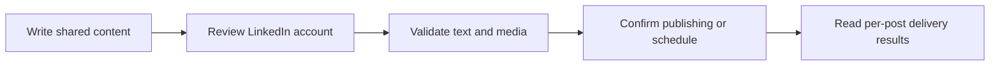

# LinkedIn

Publish individual member posts to connected LinkedIn accounts. Multiple posts are sent in order as separate posts; Posted does not turn them into a LinkedIn reply thread.

## Connect an account

<Steps>
  <Step title="Configure the provider">Add the required environment variables below to your Posted installation.</Step>
  <Step title="Authorize the account">A team administrator opens **Connections → Add connection**, chooses **LinkedIn**, and completes the provider’s sign-in and consent flow.</Step>
  <Step title="Choose it in the composer">After returning to Posted, confirm that the account is Connected. Select it through **Choose Accounts**, review its preview and customize its text or media if needed.</Step>
</Steps>

Accounts belong to the team. Connecting the same provider account again refreshes the existing connection. Members can compose for connected accounts; only administrators can add or disconnect them.

## Required environment variables

Add these values to both the API and worker services, then restart them to apply the configuration.

```dotenv title="Environment variables"
POSTED_LINKEDIN_CLIENT_ID=YOUR_LINKEDIN_CLIENT_ID
POSTED_LINKEDIN_CLIENT_SECRET=YOUR_LINKEDIN_CLIENT_SECRET
```

## Application configuration

Enable identity and member-sharing access in your LinkedIn application. Posted publishes as the connected member. Organization pages are not supported.

Register this callback URL in your LinkedIn application:

```text title="Callback URL"
{{POSTED_API_URL}}/api/social/callback/linkedin
```

Posted requests `openid`, `profile`, `w_member_social`.

Posted uses LinkedIn API version `202609`. The version is managed by Posted and changes through application upgrades.

Follow the provider's [official authorization documentation](https://learn.microsoft.com/en-us/linkedin/consumer/integrations/self-serve/share-on-linkedin) to register your application and complete any approval steps.

## Limits enforced by Posted

| Content        | Posted behavior                  |
| -------------- | -------------------------------- |
| Text           | 3,000 characters per post        |
| Attachments    | Up to 20 images **or** one video |
| Video duration | 3–1,800 seconds                  |
| Sequence       | Ordered individual posts         |

These are Posted’s current delivery limits. Use [list_providers](/mcp-reference/list_providers) or the provider API endpoint to inspect the running installation’s capabilities. Uploaded originals are prepared for the provider at delivery time; provider account permissions and quotas still apply.

## Posts, media and threads

GIFs are delivered as animated GIFs. Use one GIF without other attachments in the same post. See [Images, GIFs and videos](/media) for upload limits and preparation.

Use images or one video for each post. For a sequence, account previews keep individual posts visually separate. Later posts still wait for the preceding item on that account to publish successfully.

Each post has independent text and attachment order. Account-specific edits affect only that account and post. **Reset to master** restores text and media inheritance after confirmation. Image or video publishing requires [S3 source](/configuration#s3-source).



Read [Compose a post](/composer) for single posts and [Compose threads](/threads) for insertion, ordering, reply links and failure handling.

## Reconnect and troubleshoot

If the account needs reauthentication, an administrator repeats the official authorization flow. If LinkedIn is missing from Add connection, ask the operator to check the complete provider configuration and deploy the saved runtime values. A callback mismatch must be corrected in the provider application using the API origin, not the UI or documentation domain.

Inspect [Publish history](/deliveries) for each account's result. A confirmed provider publication stays published if another account fails. An **Uncertain** result needs provider-side inspection before another posting request. Disconnecting prevents later use of the account and does not remove existing provider posts.
