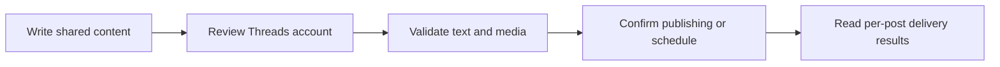

Publish text, images, videos, mixed carousels and linked reply sequences to team-owned Threads accounts.

## Connect an account

<Steps>
  <Step title="Configure the provider">
    Add the required environment variables below to your Posted installation.
  </Step>
  <Step title="Authorize the account">
    A team administrator opens **Connections → Add connection**, chooses
    **Threads**, and completes the provider’s sign-in and consent flow.
  </Step>
  <Step title="Choose it in the composer">
    After returning to Posted, confirm that the account is Connected. Select it
    through **Choose Accounts**, review its preview and customize its text or
    media if needed.
  </Step>
</Steps>

Accounts belong to the team. Connecting the same provider account again refreshes the existing connection. Members can compose for connected accounts; only administrators can add or disconnect them.

## Required environment variables

Add these values to both the API and worker services, then restart them to apply the configuration.

```dotenv title="Environment variables"
POSTED_THREADS_CLIENT_ID=YOUR_THREADS_CLIENT_ID
POSTED_THREADS_CLIENT_SECRET=YOUR_THREADS_CLIENT_SECRET
```

## Application configuration

Create a Threads application with permission to read account identity and publish content. Complete any approval steps required for the accounts you want to connect.

Register this callback URL in your Threads application:

```text title="Callback URL"
{{POSTED_API_URL}}/api/social/callback/threads
```

Posted requests `threads_basic`, `threads_content_publish`.

Follow the provider's [official authorization documentation](https://developers.facebook.com/docs/threads/) to register your application and complete any approval steps.

## Limits enforced by Posted

| Content        | Posted behavior                        |
| -------------- | -------------------------------------- |
| Text           | 500 characters per post                |
| Attachments    | Up to 20 mixed image/video attachments |
| Video duration | 3–300 seconds per video                |
| Sequence       | Linked replies after the root post     |

These are Posted’s current delivery limits. Use [list_providers](/mcp-reference/list_providers) or the provider API endpoint to inspect the running installation’s capabilities. Uploaded originals are prepared for the provider at delivery time; provider account permissions and quotas still apply.

## Posts, media and threads

A Threads post can use the first 20 attachments in its chosen order, including a mixture of images and videos. For a sequence, each later post replies to the previous confirmed post on that account.

Each post has independent text and attachment order. Account-specific edits affect only that account and post. **Reset to master** restores text and media inheritance after confirmation. Image or video publishing requires [S3 source](/configuration#s3-source).



Read [Compose a post](/composer) for single posts and [Compose threads](/threads) for insertion, ordering, reply links and failure handling.

## Reconnect and troubleshoot

If the account needs reauthentication, an administrator repeats the official authorization flow. If Threads is missing from Add connection, ask the operator to check the complete provider configuration and deploy the saved runtime values. A callback mismatch must be corrected in the provider application using the API origin, not the UI or documentation domain.

Inspect [Publish history](/deliveries) for each account's result. A confirmed provider publication stays published if another account fails. An **Uncertain** result needs provider-side inspection before another posting request. Disconnecting prevents later use of the account and does not remove existing provider posts.
