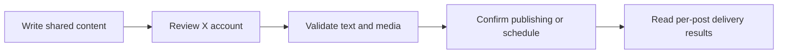

# X

Publish posts and linked reply threads to team-owned X accounts. Posted uses OAuth 2.0 with S256 PKCE and requests offline access so tokens can be refreshed.

## Connect an account

<Steps>
  <Step title="Configure the provider">The installation operator supplies `POSTED_X_CLIENT_ID` and `POSTED_X_CLIENT_SECRET` to both API and worker. Use an OAuth 2.0 confidential client with the posting and media access required by your application. X application access and provider charges are controlled by X, separately from Posted.</Step>
  <Step title="Authorize the account">A team administrator opens **Connections → Add connection**, chooses **X**, and completes the provider’s sign-in and consent flow.</Step>
  <Step title="Choose it in the composer">After returning to Posted, confirm that the account is Connected. Select it through **Choose Accounts**, review its preview and customize its text or media if needed.</Step>
</Steps>

Accounts belong to the team. Connecting the same provider account again refreshes the existing connection. Members can compose for connected accounts; only administrators can add or disconnect them.

## Application configuration

Register the exact API callback in your provider application:

```text
https://posted-api.example.com/api/social/callback/x
```

Replace the example origin with your API origin. For the hosted installation, it is `https://posted-api.avgeek.ltd/api/social/callback/x`.

Posted requests `tweet.read tweet.write users.read offline.access media.write`.

See [configuration](/configuration) for the shared runtime environment and [Towbar provider setup](/providers#configure-the-hosted-installation-in-towbar) for private value entry. Follow the provider's [official authorization documentation](https://docs.x.com/fundamentals/authentication/oauth-2-0/authorization-code) for its registration and approval process.

## Limits enforced by Posted

| Content        | Posted behavior                    |
| -------------- | ---------------------------------- |
| Text           | 280 weighted characters per post   |
| Attachments    | Up to 4 images **or** one video    |
| Video duration | 3–140 seconds                      |
| Sequence       | Linked replies after the root post |

These are Posted’s current delivery limits. Use [list_providers](/mcp-reference/list_providers) or the provider API endpoint to inspect the running installation’s capabilities. Uploaded originals are prepared for the provider at delivery time; provider account permissions and quotas still apply.

## Posts, media and threads

X counts links and Unicode using its weighted-text rules. The account editor counter reflects that weighting; a premium account does not increase Posted’s 280-character limit. Each later post replies to the immediately preceding confirmed publication on the same account.

Each post has independent text and attachment order. Account-specific edits affect only that account and post. **Reset to master** restores text and media inheritance after confirmation. Image or video publishing requires [private media storage](/configuration#private-media-storage).



Read [Compose a post](/composer) for single posts and [Compose threads](/threads) for insertion, ordering, reply links and failure handling.

## Reconnect and troubleshoot

If the account needs reauthentication, an administrator repeats the official authorization flow. If X is missing from Add connection, ask the operator to check the complete provider configuration and deploy the saved runtime values. A callback mismatch must be corrected in the provider application using the API origin, not the UI or documentation domain.

Inspect [Publish history](/deliveries) for each account's result. A confirmed provider publication stays published if another account fails. An **Uncertain** result needs provider-side inspection before another posting request. Disconnecting prevents later use of the account and does not remove existing provider posts.
