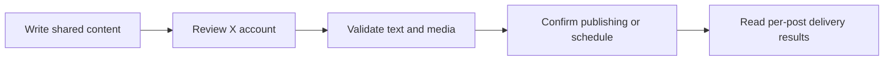

Publish posts and reply threads to your team's X accounts. First, create an X application and add its credentials to Posted. Then connect each account you want to publish from.

## Set up your X application

Sign in to the [X Developer Console](https://developer.x.com/). You will need access to a developer project. X manages API access and billing separately from Posted.

The screenshots below follow the console setup, with numbered arrows marking the controls to use. Sensitive values are blurred in the screenshots.

<Steps>
  <Step title="Start a new application">
    On the dashboard, click **New App** (arrow 1). If you already have an application for this installation, open it and continue to the authentication settings.

    <Frame caption="Start from New App on the X Developer Console dashboard.">
      
    </Frame>

  </Step>
  <Step title="Open the creation form">
    From the Apps page, click **Create App** (arrow 2).

    <Frame caption="Create App opens the application setup form.">
      
    </Frame>

  </Step>
  <Step title="Name the application and choose its project">
    Enter a name such as **Posted** (arrow 3). Under **Project Access**, select the project and choose **Production** for your live installation (arrow 4). Finish creating the application.

    <Frame caption="Give the application a name you will recognize when connecting an account.">
      
    </Frame>

  </Step>
  <Step title="Continue past the first keys screen">
    X first shows a **Consumer Key**, **Secret Key**, and **Bearer Token**. Posted does not use these values. Close this dialog and continue to the OAuth 2.0 settings below.

    <Frame caption="These initial keys are different from the OAuth 2.0 client credentials Posted needs.">
      
    </Frame>

  </Step>
  <Step title="Open user authentication settings">
    Open your application's **Keys & Tokens** tab. Under **OAuth 2.0 Keys**, click **Set up** next to **User authentication settings** (arrow 5).

    <Frame caption="Set up user authentication so accounts can authorize Posted.">
      
    </Frame>

  </Step>
  <Step title="Choose the application type">
    Under **App permissions** (arrow 6), select access based on the scope of your Posted use. Choose **Read and write** for publishing, or **Read and write and Direct message** if your use also includes direct messages. Set **Request email from users** according to your needs.

    Under **Type of App**, select **Web App, Automated App or Bot** (arrow 7). This creates a confidential client with a client secret.

    <Frame caption="Select the confidential client type under Type of App.">
      
    </Frame>

  </Step>
  <Step title="Add your callback and website URLs">
    In **Callback URI / Redirect URL** (arrow 8), enter your Posted API URL followed by `/api/social/callback/x`. Replace `{{POSTED_API_URL}}` with your API origin, including `https://`.

    ```text title="Callback URL"
    {{POSTED_API_URL}}/api/social/callback/x
    ```

    In **Website URL** (arrow 9), enter your Posted web address. Fill in your organization details and any policy URLs required by X, then click **Save Changes**.

    <Frame caption="Use your API address for the callback and your web address for Website URL.">
      
    </Frame>

  </Step>
  <Step title="Save the OAuth 2.0 credentials">
    Copy the **Client ID** (arrow 10) and **Client Secret** (arrow 11). Store the secret securely before closing the dialog.

    <Frame caption="Copy these two OAuth 2.0 values into your Posted installation settings.">
      
    </Frame>

  </Step>
</Steps>

X's [OAuth 2.0 setup reference](https://docs.x.com/fundamentals/authentication/oauth-2-0/authorization-code) explains confidential clients and callback matching.

## Required environment variables

Add these values to your Posted installation on both the API and worker services. Use the **OAuth 2.0 Client ID and Client Secret** from the final step, then restart the services to apply the configuration.

```dotenv title="Environment variables"
POSTED_X_CLIENT_ID=YOUR_X_CLIENT_ID
POSTED_X_CLIENT_SECRET=YOUR_X_CLIENT_SECRET
```

Posted requests `tweet.read`, `tweet.write`, `users.read`, `offline.access`, `media.write`. Offline access lets Posted refresh the connection for scheduled posts.

## Connect an account

<Steps>
  <Step title="Open Connections">
    In Posted, a team administrator opens **Connections → Add connection** and
    chooses **X**.
  </Step>
  <Step title="Authorize the account">
    Sign in to the X account you want to connect and approve the access request.
    X returns you to Posted after authorization.
  </Step>
  <Step title="Confirm the connection">
    Check that the account appears as **Connected**. It is now available through
    **Choose Accounts** in the composer. Review its preview and customize the
    text or media if needed.
  </Step>
</Steps>

Accounts belong to the team. Connecting the same X account again refreshes its existing connection. Members can compose for connected accounts; only administrators can add or disconnect them.

## Limits enforced by Posted

| Content        | Posted behavior                    |
| -------------- | ---------------------------------- |
| Text           | 280 weighted characters per post   |
| Attachments    | Up to 4 images **or** one video    |
| Video duration | 3–140 seconds                      |
| Sequence       | Linked replies after the root post |

These are Posted’s current delivery limits. Use [list_providers](/mcp-reference/list_providers) or the provider API endpoint to inspect the running installation’s capabilities. Uploaded originals are prepared for the provider at delivery time; provider account permissions and quotas still apply.

## Posts, media and threads

Posted uses X's `twitter-text` library for the character counter and publishing validation. A recognized URL counts as 23 characters, and an emoji counts as 2, including joined emoji such as families. The same counting rules apply in the account editor and on the server. See [X's character-counting rules](https://docs.x.com/fundamentals/counting-characters).

Posted currently limits every connected X account to 280 weighted characters. X offers [longer posts for eligible subscribers](https://help.x.com/en/using-x/types-of-posts), but Posted does not yet detect that eligibility or enable the higher limit.

Each later post replies to the immediately preceding confirmed publication on the same account.

Each post has independent text and attachment order. Account-specific edits affect only that account and post. **Reset to master** restores text and media inheritance after confirmation. Image or video publishing requires [S3 source](/configuration#s3-source).



Read [Compose a post](/composer) for single posts and [Compose threads](/threads) for insertion, ordering, reply links and failure handling.

## Reconnect and troubleshoot

If the account needs reauthentication, an administrator repeats the official authorization flow. If X is missing from Add connection, ask the operator to check the complete provider configuration and deploy the saved runtime values. A callback mismatch must be corrected in the provider application using the API origin, not the UI or documentation domain.

Inspect [Publish history](/deliveries) for each account's result. A confirmed provider publication stays published if another account fails. An **Uncertain** result needs provider-side inspection before another posting request. Disconnecting prevents later use of the account and does not remove existing provider posts.
