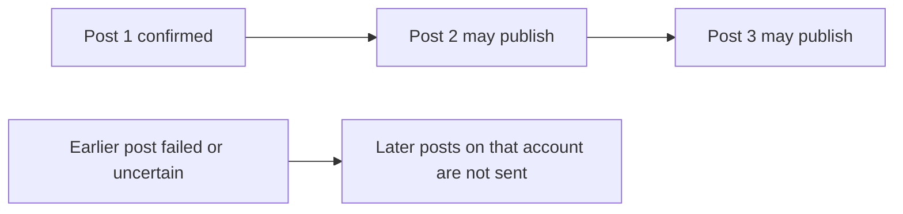

# Compose threads

A thread starts with a root post and continues with ordered posts. Posted keeps one master sequence and lets each selected account customize text and attachments for every post. X, Threads and Bluesky publish linked replies. LinkedIn and LinkedIn Pages publish the sequence as separate individual posts in the same order.

## Build the sequence

Build your thread on the left and review each account's version on the right. Each numbered card is one post. The preview connects replies so you can see how the thread will read.

<!-- screenshot:sequence -->

<Steps>
  <Step title="Write the first post">Open **Create post**, write the root text and choose accounts. Each provider applies its own text and media limits.</Step>
  <Step title="Add another post">Choose **Add Another Post** below the final card. Each numbered master post has its own text and ordered media. The label shows character and word counts.</Step>
  <Step title="Insert or reorder">Use **Insert post** between cards, drag the six-dot handle, or choose **Move up** / **Move down** in the actions menu. The whole post moves with its media and account overrides.</Step>
  <Step title="Review every account">Select an account avatar. **Preview** shows the complete sequence; **Edit** keeps all account posts expanded. On mobile, these views are inside **Accounts**.</Step>
  <Step title="Save or publish">Save the complete sequence as a pending draft, or review accounts and time before publishing or scheduling it. The action applies to the whole sequence.</Step>
</Steps>

Use the separate chevron to expand or collapse a master card. Collapsing preserves its full text and attachment summary. Account editing does not expand the master outline. Removing a master post requires confirmation because it also discards that post's attachments and account overrides.

## Customize one account

In the account's **Edit** view, change any post's text, add or remove media, or reorder attachments using the six-dot handles. A vertical drop indicator shows the attachment's insertion position. Custom text and media apply only to this account and this post.

An empty custom media selection keeps that account post text-only. **Reset to master** asks for confirmation and restores both text and attachment inheritance for that account post. Changing the selected accounts stays pending until **Choose X accounts**; removing an account with custom content also requires confirmation.

## How the providers publish a sequence

| Provider                        | Result                                                                                                             |
| ------------------------------- | ------------------------------------------------------------------------------------------------------------------ |
| [X](/providers/x)               | The first post is a root post; each later post replies to the preceding publication on that X account.             |
| [Threads](/providers/threads)   | Each later post replies to the previous post from that Threads account. A post can contain a mixed media carousel. |
| [Bluesky](/providers/bluesky)   | Later posts retain the first post as the thread root and the preceding post as their parent.                       |
| [LinkedIn](/providers/linkedin) | Each item is an individual member post, published in order. Posted does not create a LinkedIn reply thread.        |

In Preview, inset connectors identify linked replies. Separate LinkedIn posts have more space between cards. The preview illustrates the selected content; provider-side policies and access still apply.

## Delivery order and partial results

Delivery is sequential within each account. A later post waits for the preceding post to publish successfully. Accounts have independent outcomes, so one account can succeed while another fails. Inspect each account and post index in [Publish history](/deliveries).

A timeout after a provider request can leave an **Uncertain** result. Check the provider before making a new posting request; do not resend the entire thread to repair one uncertain item. Replaying the original request with its original key does not republish confirmed posts.

Temporary failures are retried with increasing delays when Posted can safely send again. If retries run out, **Resume publishing** in delivery details continues the failed remainder for one account and preserves earlier publications. Accounts with uncertain results remain blocked. See [automatic retries and resume](/deliveries#automatic-retries).

## Save, edit and cancel

[Pending drafts](/drafts) retain the full sequence, selected accounts, text overrides and attachment order without creating delivery jobs. An entirely [scheduled sequence](/scheduling) can be edited with its current version. Once preparation or publication starts, editing is blocked. Cancellation stops eligible pending work and never removes provider-side posts that are already published.

## API and MCP

The root request is the first post; `additionalPosts` contains the remaining items. Each can have `textOverrides`, `mediaIds` and `mediaOverrides`. `connectionIds`, `scheduledAt` and `idempotencyKey` belong to the whole sequence. Use the latest draft or post version when saving an edit.

See [create_post](/mcp-reference/create_post), [save_draft](/mcp-reference/save_draft) and the [HTTP request conventions](/api-reference/overview).

LinkedIn Pages follows the same sequence behavior as LinkedIn: individual Page posts are published in order, without reply links.
